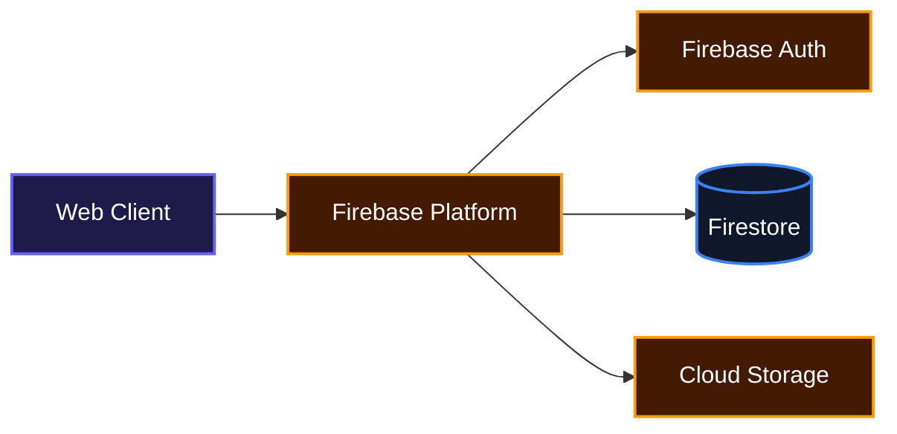
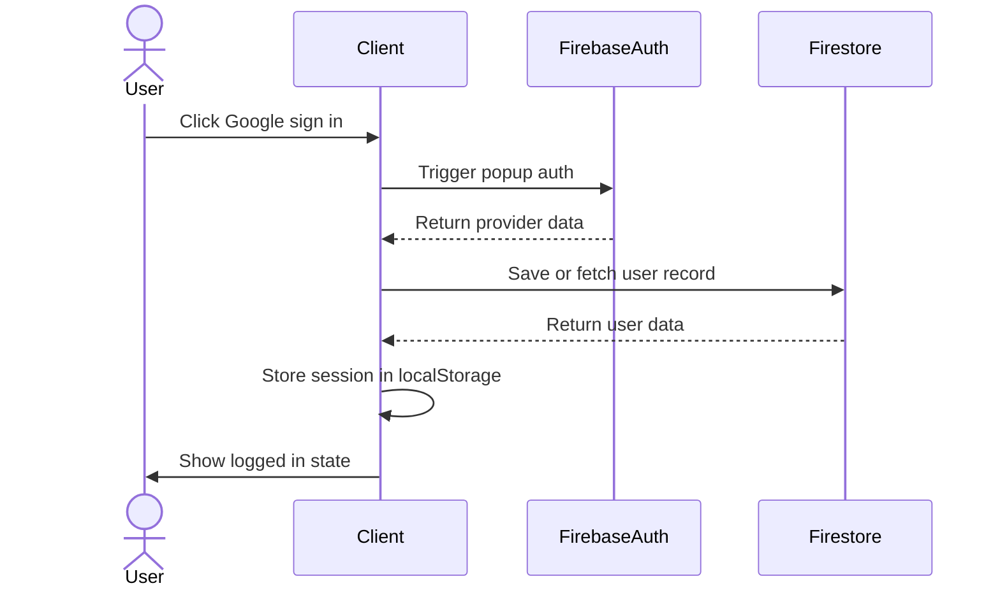
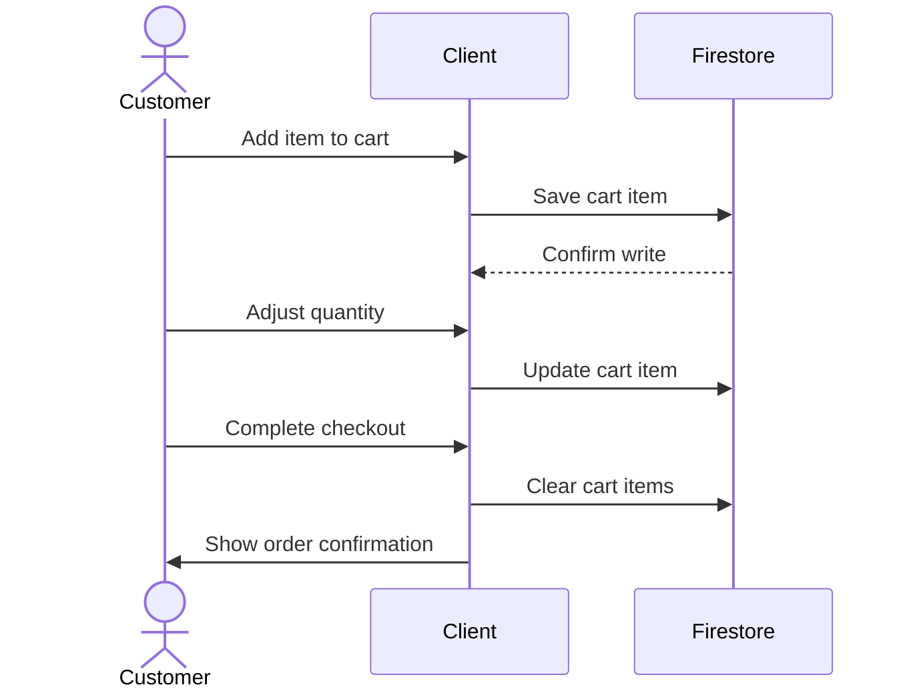
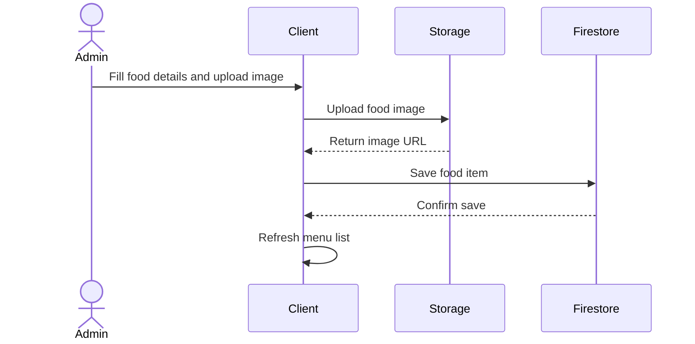

# Chronicles Restaurant

Chronicles Restaurant is the online storefront for THE PROMISE, a Nigerian restaurant based in Abakaliki. It lets hungry customers browse the menu, build a cart, and check out, while giving the kitchen team an admin dashboard to manage dishes and users. Everything syncs in real time so the menu, cart, and user data stay up to date across devices.

## System Architecture



## Features

**Menu browsing and filtering**
Customers can explore Nigerian dishes by category, including soups, swallows, rice, grills, pepper soup, fish, and drinks. A fallback local menu keeps the store populated even when the backend is empty.

**Cart and checkout**
Logged-in users add items, adjust quantities, remove entries, and complete a checkout flow with mobile money or card payment options. The cart total updates automatically.

**User authentication**
Supports email and password registration, email login, and Google sign-in through Firebase Auth. Sessions persist across page reloads.

**Admin dashboard**
Authorized admins can add new food items with image uploads, view the full menu, browse registered users, and switch between dashboard sections from a dedicated side navigation.

**Profile management**
Users can update their display name, phone number, and profile photo, with images uploaded directly to Firebase Storage.

**Responsive design**
The app works on desktop and mobile, with a tailored mobile navigation, touch-friendly cart drawer, and contact form slide-out.

### Authentication Flow



### Cart and Checkout Flow



### Admin Add Food Flow



## Installation

1. Clone the repository:

```bash
git clone https://github.com/fluxaro/Chronicles.git
```

2. Move into the project folder:

```bash
cd Chronicles
```

3. Install dependencies:

```bash
npm install
```

4. Create a `.env` file in the project root and add your Firebase config values:

```env
REACT_APP_FIREBASE_API_KEY=your_api_key
REACT_APP_FIREBASE_AUTH_DOMAIN=your_project.firebaseapp.com
REACT_APP_FIREBASE_DB_URL=https://your_project.firebaseio.com
REACT_APP_FIREBASE_PROJECT_ID=your_project_id
REACT_APP_FIREBASE_STORAGE_BUCKET=your_project.appspot.com
REACT_APP_FIREBASE_MESSAGING_ID=your_messaging_sender_id
REACT_APP_FIREBASE_APP_ID=your_app_id
REACT_APP_FIREBASE_MEASUREMENT_ID=your_measurement_id
```

5. Start the development server:

```bash
npm start
```

The app will open at `http://localhost:3000`.

## Usage

Once the app is running, you can browse the menu from the home page or the dedicated menu page. Add dishes to your cart, then log in or sign up to complete checkout.

To access the admin dashboard, sign in with one of the admin emails configured in the app and visit `/admin`. From there you can add new menu items, view existing dishes, and manage users.

Run the test suite with:

```bash
npm test
```

Build for production with:

```bash
npm run build
```

## Technologies Used

| Technology | Purpose |
| --- | --- |
| [TypeScript](https://www.typescriptlang.org/) | Type-safe component and utility development |
| [React](https://react.dev/) | Component-based user interface |
| [React Router](https://reactrouter.com/) | Client-side routing |
| [Firebase](https://firebase.google.com/) | Authentication, Firestore database, and image storage |
| [Tailwind CSS](https://tailwindcss.com/) | Utility-first styling |
| [Framer Motion](https://www.framer.com/motion/) | Page and component animations |
| [React Toastify](https://fkhadra.github.io/react-toastify/) | User notifications |
| [Vercel](https://vercel.com/) | Deployment configuration |

## Firebase Operations

This project does not expose custom REST endpoints. Instead, the React client talks directly to Firebase through the helpers in `src/Firebase/index.js`.

| Operation | Description |
| --- | --- |
| `AUTHPROVIDER(provider)` | Signs a user in with a Firebase OAuth provider and stores the profile. |
| `EMAILSIGNUP(email, password)` | Creates a new account with email and password. |
| `EMAILSIGNIN(email, password)` | Signs in an existing user and returns their Firestore profile. |
| `firebaseFetchFoodItems()` | Fetches all food items from Firestore, shuffled. |
| `firebaseSaveProduct(data)` | Adds or updates a food product in Firestore. |
| `firebaseDeleteFood(id)` | Removes a food product by ID. |
| `firebaseAddToCart(data)` | Adds an item to the cart collection. |
| `firebaseFetchAllCartItems()` | Fetches every cart item from Firestore. |
| `firebaseUpdateCartItem(data)` | Updates a cart item quantity. |
| `firebaseDeleteCartItem(item)` | Removes a single cart item. |
| `firebaseEmptyUserCart(cartItems)` | Clears all cart items for the current user. |
| `firebaseAddUser(data)` | Saves a new user profile to Firestore if it does not exist. |
| `firebaseGetUser(uid)` | Fetches a single user by UID. |
| `firebaseUpdateUser(data)` | Updates an existing user profile. |
| `firebaseGetAllUsers()` | Fetches all registered users. |
| `firebaseUploadImage(...)` | Uploads an image to Firebase Storage with progress tracking. |
| `firebaseRemoveUploadedImage(...)` | Deletes an uploaded image from Firebase Storage. |

### Environment Variables

| Variable | Example |
| --- | --- |
| `REACT_APP_FIREBASE_API_KEY` | `AIzaSyB...` |
| `REACT_APP_FIREBASE_AUTH_DOMAIN` | `chronicles-restaurant.firebaseapp.com` |
| `REACT_APP_FIREBASE_DB_URL` | `https://chronicles-restaurant.firebaseio.com` |
| `REACT_APP_FIREBASE_PROJECT_ID` | `chronicles-restaurant` |
| `REACT_APP_FIREBASE_STORAGE_BUCKET` | `chronicles-restaurant.appspot.com` |
| `REACT_APP_FIREBASE_MESSAGING_ID` | `123456789012` |
| `REACT_APP_FIREBASE_APP_ID` | `1:123456789012:web:abcdef123456` |
| `REACT_APP_FIREBASE_MEASUREMENT_ID` | `G-XXXXXXXXXX` |

## Contributing

Contributions are welcome. If you spot a bug or want to add a feature, feel free to open an issue or submit a pull request. Keep changes focused, write clear commit messages, and make sure the project still builds before submitting.

## Author

- LinkedIn: [Ugochukwu Nweze](https://linkedin.com/in/ugochukwu-nweze-08812a2b8)
- X: [CodesNum80638](https://x.com/CodesNum80638)

## Badges

[](https://www.typescriptlang.org/)
[](https://react.dev/)
[](https://firebase.google.com/)
[](https://tailwindcss.com/)
[](https://vercel.com/)
